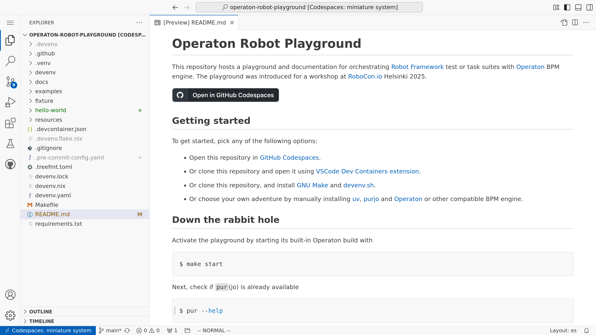
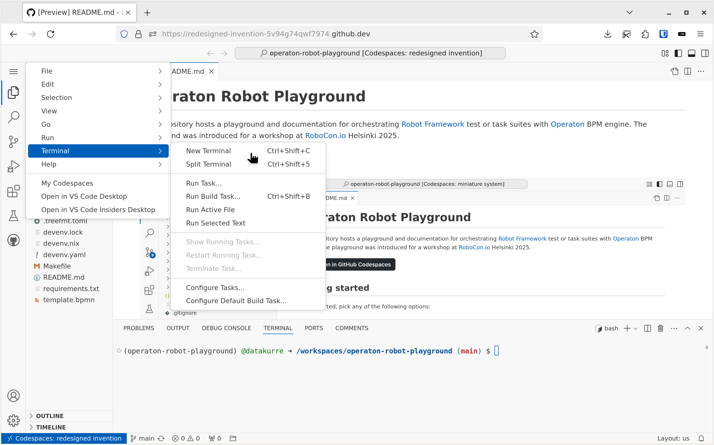
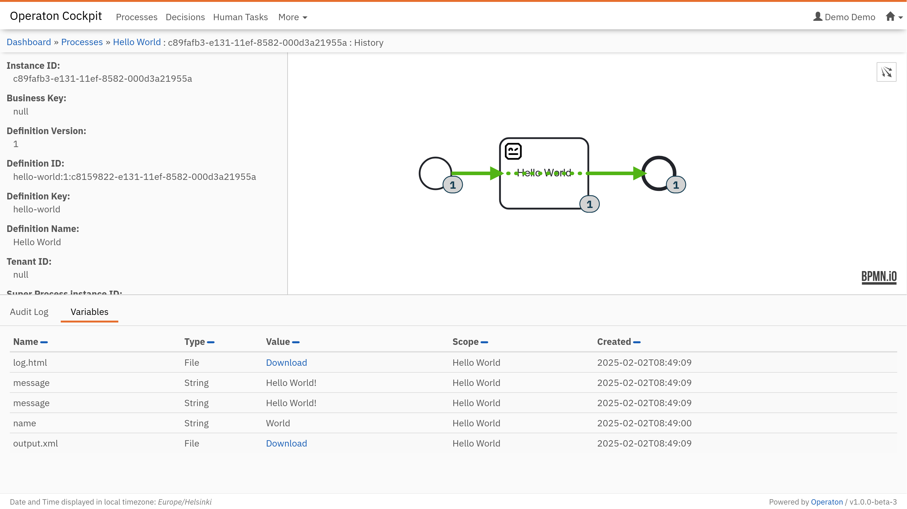
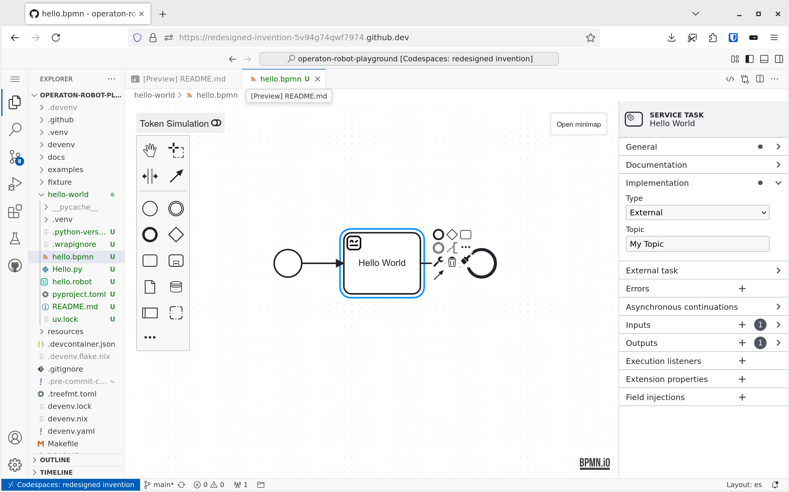
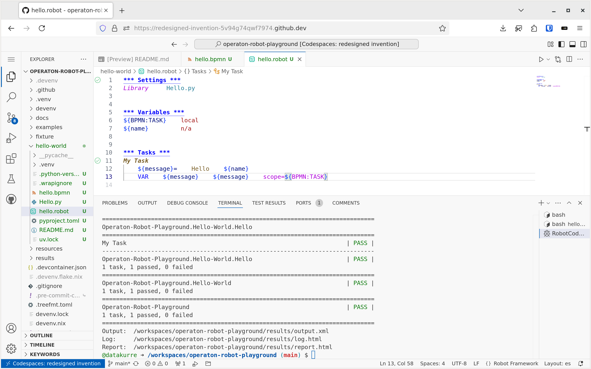
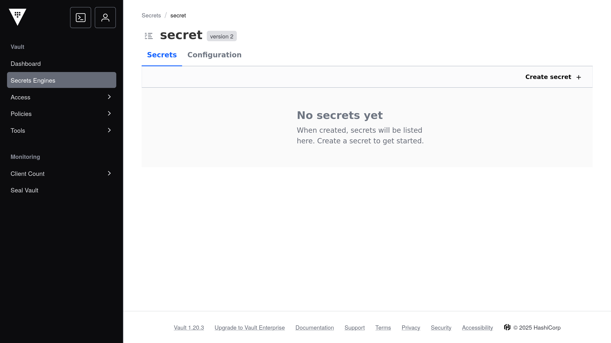

# Operaton Robot Playground

[Operaton Robot Playground](https://github.com/datakurre/operaton-robot-playground) is a [VSCode](https://code.visualstudio.com/) [Dev Container](https://code.visualstudio.com/docs/devcontainers/containers) based development environment that supports [GitHub Codespaces](https://codespaces.new/datakurre/operaton-robot-playground). It can also be run locally with the VSCode [extension](https://marketplace.visualstudio.com/items?itemName=ms-vscode-remote.remote-containers). For adventurers, the [README](https://github.com/datakurre/operaton-robot-playground#getting-started) also mentions more manual setups.

Technically, the playground is just a git repository containing both this documentation and the development environment configuration. There are a lot of files, but don't be afraid of them.

## Terminal

Using the playground requires substantial use of the terminal because the main tools used, [`uv`](https://docs.astral.sh/uv/), [`pur`(jo)](https://pypi.org/project/purjo/), and [`robot`](https://robotframework.org/), are all command line tools.

A new terminal can be launched using the shortcut `Ctrl+Shift+S` or `Cmd+Shift+S`. Alternatively, it can be found from the menu `Terminal > New Terminal`. Or with editor command `> Terminal: Create New Terminal`.

If the terminal does not start with the default Python virtual environment `(operaton-robot-playground)` activated, it should be activated by typing the command `make shell` into each new terminal.

## Operaton

BPMN-driven orchestration requires a BPM engine capable of executing BPMN models. The playground provides a preconfigured [Operaton](https://operaton.org/) BPM engine, which is a Java-based open-source BPM engine, forked from the popular Camunda 7 CE.

The current version is `1.0.0b3` with JSON support ("SPIN") and the currently required [UI plugin for displaying process instance histories](https://github.com/datakurre/operaton-cockpit-plugins).

Operaton is started from the terminal in the background with the command `make start`. Once started, the editor will prompt you to open the Operaton UI in a new browser tab. The playground username is `demo` and the password is `demo`.

If you need to see the console output of Operaton, you can attach to its monitor with `make start-monitor`.

The raw `devenv` command to start Operaton and attach the monitor all at once in the same terminal is `devenv up`.

## Operaton BPMN, DMN & Form Modelers

For creating and editing BPMN 2.0, DMN, and form diagrams for Operaton, the playground uses opinionated extensions published by **datakurre** directly on the [Visual Studio Marketplace](https://marketplace.visualstudio.com/publishers/datakurre):
- [Opinionated BPMN 2.0 Modeler](https://marketplace.visualstudio.com/items?itemName=datakurre.vscode-operaton-bpmn-js-modeler) (`datakurre.vscode-operaton-bpmn-js-modeler`)
- [Opinionated DMN 1.3 Modeler](https://marketplace.visualstudio.com/items?itemName=datakurre.vscode-operaton-dmn-js-modeler) (`datakurre.vscode-operaton-dmn-js-modeler`)
- [Opinionated Form Modeler](https://marketplace.visualstudio.com/items?itemName=datakurre.vscode-operaton-form-js-modeler) (`datakurre.vscode-operaton-form-js-modeler`)

Any `.bpmn`, `.dmn`, or `.form` file opened in the editor will be rendered automatically in the visual modeler. The modelers are based on [BPMN.io](https://bpmn.io/) libraries, enhanced with Operaton/Camunda 7 element templates, transaction boundary overlays, token simulation, and real-time linting.

### Creating diagrams directly from the modeler

You can create new BPMN diagrams directly from VS Code without needing terminal commands:
- **Command Palette**: Press `Ctrl+Shift+P` (or `Cmd+Shift+P` on macOS) and run **`BPMN Modeler: Create New Diagram`**.
- **Explorer Context Menu**: Right-click any folder or empty space in the file explorer and select **`BPMN Modeler: Create New Diagram`**.
- Enter your desired diagram filename (ending in `.bpmn`).

*(Creating files via the terminal with `pur operaton create <filename>.bpmn` remains supported as well.)*

### Deploying diagrams with the Deployment button

The modeler includes a dedicated **Deploy** button in the editor toolbar. Clicking Deploy sends the active process diagram directly to the running Operaton engine's REST API (`http://localhost:8080/engine-rest`). You can also configure a custom REST endpoint in settings (`bpmnModeler.engineRestUrl`).

## RobotCode

Another extension preinstalled in the playground is [RobotCode](https://marketplace.visualstudio.com/items?itemName=robotframework.robotframework). It's the famous extension adding Robot Framework IntelliSense, linting, test execution and debugging, code formatting, refactoring, and many more features right into the editor.

RobotCode features are available in any `.robot` file opened in the editor.

RobotCode requires a Python virtualenv with the `robotframework` package preinstalled. The playground provides one right at `.venv` to support the autodiscovery in the editor. If the virtualenv is missing for some reason, try `make shell` in the terminal to recreate it.

## Vault / secrets management

Sooner than later, running automation against external systems means you’ll need **secrets** (API keys, credentials, tokens). In this playground, secrets handling is primarily documented and implemented via `pur`(jo)’s secrets support.

To keep this introduction page self-contained:

- For local demos, `pur`(jo) can read secrets from a local JSON file (never commit it).
- For real environments, prefer a dedicated secret manager. `pur`(jo) supports a Vault provider (and expects `VAULT_ADDR` + `VAULT_TOKEN`).

The playground defines these automatically in its environment (check `env|grep VAULT` in terminal).

See the full details in the `pur`(jo) docs: [Managing secrets](../purjo/index.md#managing-secrets).

## `uv`

[`uv`](https://docs.astral.sh/uv/) is an extremely fast Python package and project manager, written in Rust. It is a single tool that replaces most of the existing Python packaging and virtual environment tools.

The default Python virtual environment in the playground is managed with `uv`. New packages can be installed into it using the command `uv pip install`. Later, `uv` is also used for managing custom Robot Framework test/task suite package dependencies with its `uv add` command, and for executing them with the `pur`(jo) tool.

If `uv` is not available in the terminal, it should become available with the command `make shell` in the terminal.

## `pur`(jo)

[`pur`(jo)](https://pypi.org/project/purjo/) is a *work-in-process* tool for managing and executing Robot Framework test / task suite packages for BPMN-driven orchestration.

We'll cover more about `pur`(jo) in the next sections of this documentation.